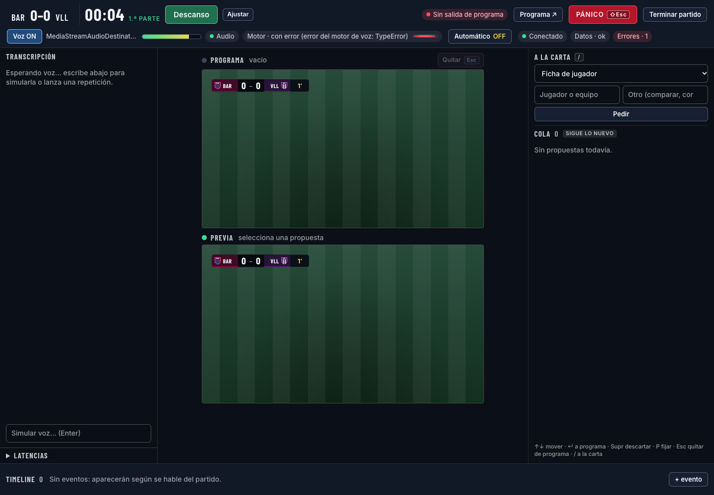
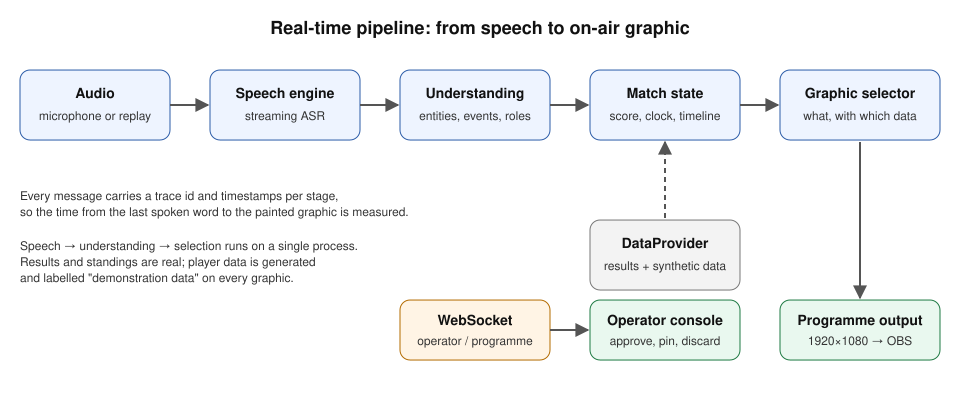
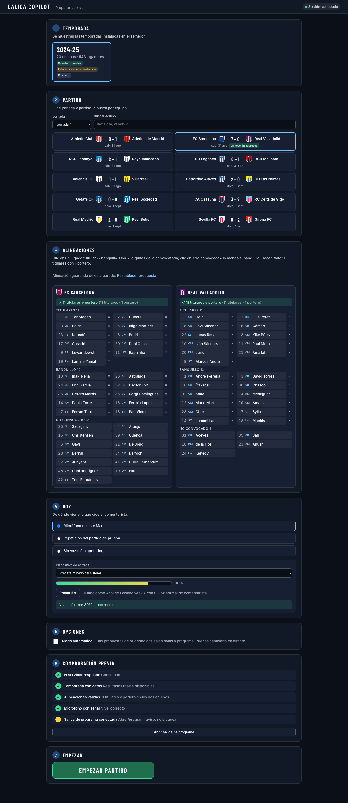
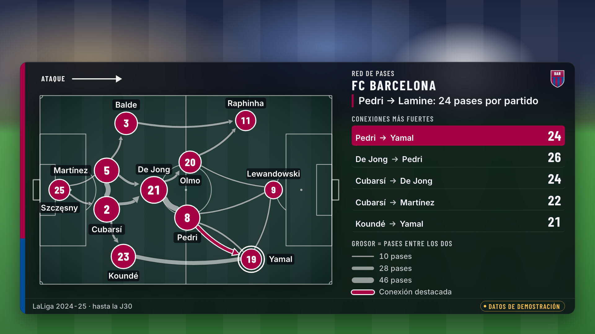
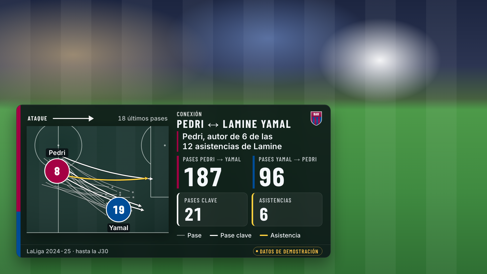
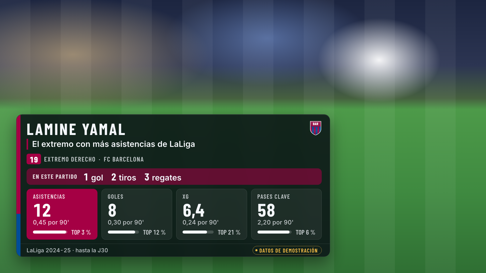
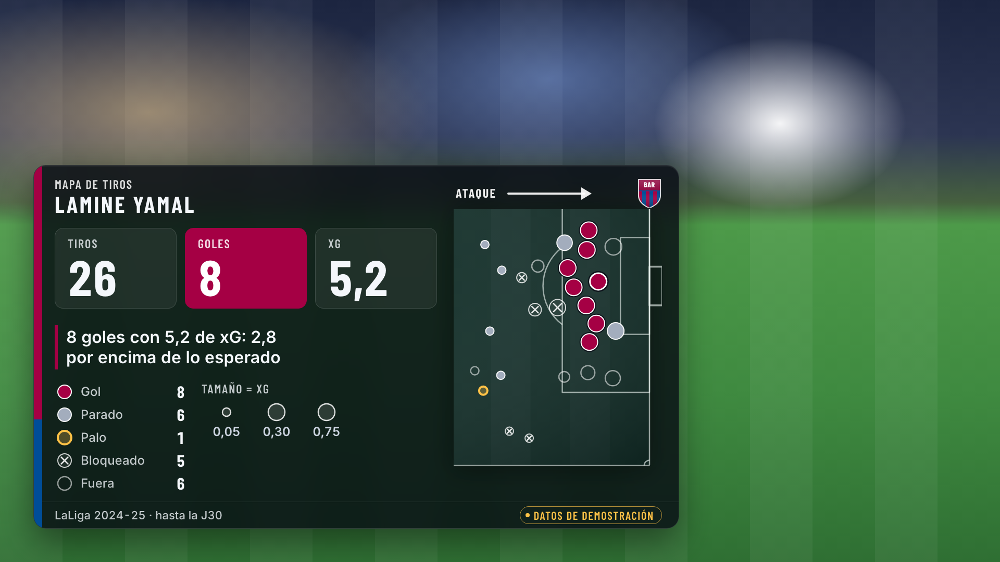
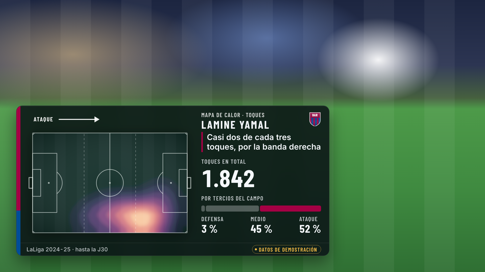
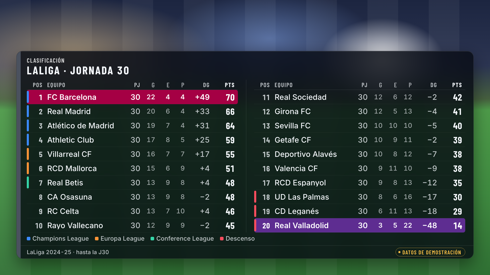
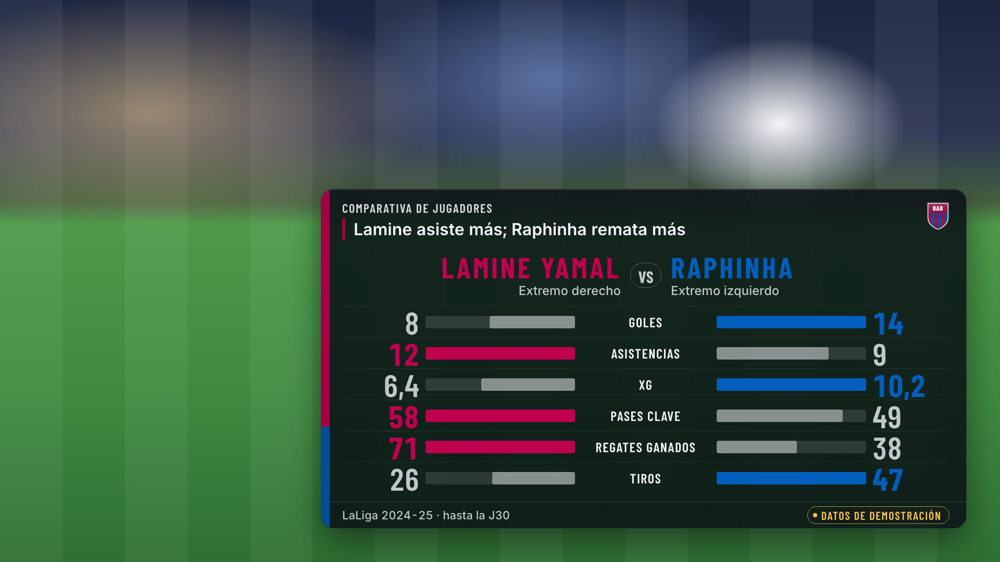

# LaLiga Copilot

**Real-time broadcast graphics for football commentators.** While the commentator speaks, the system transcribes the
audio, works out *who did what to whom*, and proposes (or launches) on-air graphics: player cards, pass networks,
player-to-player connections, xG shot maps, heat maps, comparisons, league tables, head-to-head records, situation
boards and match timelines.

Everything runs **locally, with no paid services and no API keys**. The speech recognition, the language
understanding, the graphics engine and the broadcast output all live on one laptop.



> The product's UI and graphics are in Spanish because the target users are Spanish-language commentators. This
> README, the architecture notes and the final report are in English.
>
> Player and event data are **demonstration data** (generated, internally consistent and reproducible). Every graphic
> that uses them is labelled *"Datos de demostración"* on screen. League standings and results come from
> [openfootball](https://github.com/openfootball/football.json) (real data).

---

## What is interesting here

- **Streaming pipeline with measured latency.** Audio → speech recognition → language understanding → match state →
  graphic selection → WebSocket → broadcast output. Every message carries a trace id and per-stage timestamps, so the
  end-to-end time from the last spoken word to the painted graphic is measured, not guessed.
- **Deterministic language understanding.** Entity resolution (exact, alias, ASR-alias, Spanish phonetic and bounded
  fuzzy matching), event catalogue, role linking (who passed to whom, who fouled whom), modality detection (negated,
  hypothetical, past, query) and chain linking. Under 3 ms per sentence, and fully explainable.
- **A match-state engine.** It de-duplicates goals that the commentator repeats, separates "singing a goal" from
  "recalling one", retracts disallowed goals and validates substitutions against the official line-up.
- **An evaluation harness with a frozen test split.** Gold annotations are split by group (not by sentence) so that
  template variants never leak across dev and test. The test split is locked by a SHA-256 manifest and is only used
  for headline numbers. The results are reported honestly, including the parts that do not meet the targets (see
  [`docs/FINAL_REPORT.md`](docs/FINAL_REPORT.md)).
- **Swappable speech engines behind one interface.** Whisper (MLX), Parakeet (MLX), Vosk and Web Speech are compared on
  the same audio with word error rate, proper-noun error rate and word-appearance latency, and a supervisor falls back
  to a second engine if the first one fails or lags.
- **Data layer behind a `DataProvider` interface.** The synthetic provider generates ~470 000 coherent events with
  coordinates, passes and xG, and aggregates are computed from those events. A point-in-time cut (`until`) means a
  live broadcast of matchday 4 only "knows" what happened before matchday 4.

## Architecture



| Layer | Path | What it does |
|---|---|---|
| Speech | `copilot/asr/` | Streaming engines behind `AsrEngine`; microphone, file and replay audio sources |
| Understanding | `copilot/nlu/` | Normalisation, entities, catalogue, roles, context and coreference, modality, chains |
| Match state | `copilot/match/` | Timeline, goal de-duplication, substitutions, scoreline |
| Graphics | `copilot/graphics/` | Chooses the graphic, builds the payload for each of the 12 types |
| Data | `copilot/data/`, `data/` | `DataProvider` (synthetic + real results), `ImageProvider` (generated SVG crests and silhouettes) |
| Server | `copilot/server/` | FastAPI, REST endpoints for health and metrics, WebSocket channels for operator and programme output |
| Frontend | `web/` | React + TypeScript + Vite; the pitch is drawn in SVG; operator console, programme output, gallery |
| Evaluation | `eval/` | Gold annotation tools, metrics, ASR and latency benchmarks |

Design decisions and the alternatives that were rejected are documented in
[`docs/ARCHITECTURE.md`](docs/ARCHITECTURE.md).

## The screens

| Operator console | Setup menu |
|---|---|
|  |  |

| Pass network | Player connection |
|---|---|
|  |  |

| Player card | Shot map |
|---|---|
|  |  |

| Heat map | League table |
|---|---|
|  |  |

| Comparison | Scorebug |
|---|---|
|  |  |

## How a match works

1. `make dev` opens the **setup menu** at http://localhost:5173/setup: pick the season and the match, check the
   line-ups (a proposed XI, editable), choose the audio source (this Mac's microphone with a level meter, a replay of a
   test match, or no voice), and run the pre-match check.
2. Press **kick-off** in the operator console. The clock, half-time, full-time and corrections live in the same
   panel.
3. Speech is transcribed continuously. Each sentence is analysed; confident, safe events (goals, substitutions, cards)
   can go on air automatically, and everything else arrives in a **proposal queue** for the operator to accept, pin,
   discard or send to air with the keyboard.
4. The programme output at http://localhost:5173/program is a transparent 1920×1080 page. In OBS, add it as a
   *Browser Source* and it composites over the broadcast.
5. A **panic** shortcut clears the programme output and turns automatic mode off.
6. *End match* archives the session.

If the server crashes, run `make dev` again: the match is restored from `data/sessions/current.json` with its score,
events and clock.

## Quick start

Requirements: macOS on Apple Silicon (developed on an M-series Mac with 16 GB RAM) and an internet connection for the
first run.

```bash
make dev
```

The script installs everything **without sudo**, inside the project folder: `uv`, Node 22 and `ffmpeg` in `.tools/`,
Python 3.12 in `.venv/`. It then generates the demonstration data and starts the backend (port 8765) and the frontend
(port 5173).

| Page | URL | Purpose |
|---|---|---|
| Setup | http://localhost:5173/setup | prepare a match |
| Operator | http://localhost:5173/ | clock, microphone, transcript, proposal queue, timeline, panic |
| Programme | http://localhost:5173/program | 1920×1080 transparent output for OBS |
| Gallery | http://localhost:5173/gallery | the 12 graphics with sample data |

Useful commands:

| Command | What it does |
|---|---|
| `make dev` | install and start everything |
| `make test` | Python tests (and frontend tests if present) |
| `make data` | regenerate the demonstration database (fixed seed, ~130 MB, not versioned) |
| `make eval` | metrics table on the dev split (needs the private evaluation data, see below) |

Configuration lives in `config/default.yaml`. Override any value in `config/local.yaml` or with environment
variables such as `COPILOT_GRAPHICS__AUTO_PROGRAM=true make dev`.

## About the evaluation data

The annotated gold sets and the match audio are **not** in this repository. The audio is third-party broadcast
material, and the transcripts and annotations derived from it cannot be redistributed. The evaluation code is here;
tests that need the private data are skipped automatically.

## Honest status

The project is a working prototype, not a production product. The short version of
[`docs/FINAL_REPORT.md`](docs/FINAL_REPORT.md):

- Working end to end: the backend, the operator console, the programme output, 12 graphics, the match-state engine,
  and a generated data layer with consistency tests.
- Measured on one match with one commentator, and not met yet: event understanding on the held-out half of the
  audio, substitution detection, proper-noun accuracy with streaming speech, and end-to-end latency at the 800 ms
  target.
- Not yet done: a real licensed data feed, a test in OBS, and validation with a professional operator.

The report lists every limit of every number. Please read it before quoting any figure.

## Repository layout

```
copilot/     Python backend (speech, understanding, match state, graphics, data, server, observability)
web/         React + TypeScript frontend
data/        real 2024-25 squads (public facts), real results, synthetic data generator and its tests
eval/        evaluation tools and metric code (data not included)
config/      default configuration
docs/        architecture and final report
legacy/      the original single-page prototype, kept as a baseline for comparison
tests/       pytest suite
```

## License

Source code: all rights reserved unless a license file is added. Real league results: openfootball (public domain /
CC0 for facts). Squad lists are compiled from public information. Crests and photos are not used; the app draws its
own generic silhouettes and shields.
